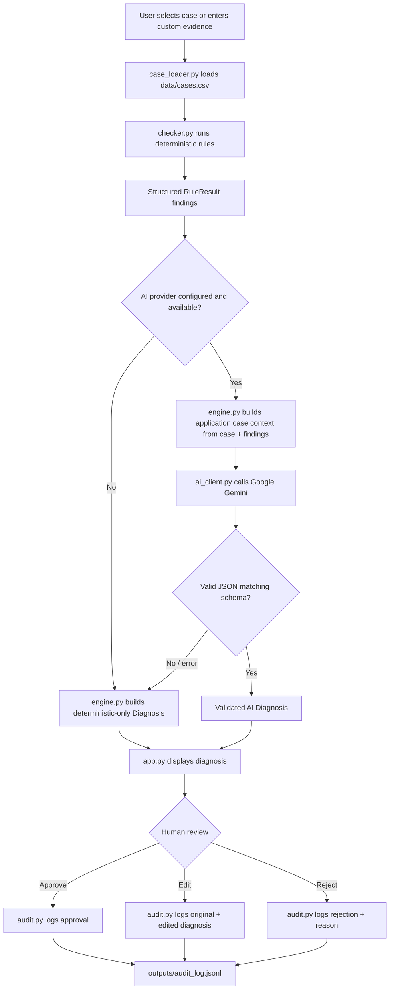

# Architecture

## Design principle

NetSage AI is a **decision-support tool**, not an autonomous network
controller. The AI is never the sole source of truth: deterministic,
regex-based rule checks always run first and are always shown to the
user; Gemini is asked to explain and prioritize among that evidence,
not replace it. A human always approves, edits, or rejects the final
diagnosis, and every decision is logged.

## Pipeline

```
Application loads selected case
        |
        v
Case/evidence loaded (src/case_loader.py, data/cases.csv)
        |
        v
Deterministic rule checker (src/checker.py)
        |
        v
Structured findings (List[RuleResult])
        |
        v
AI diagnosis/explanation (src/engine.py -> src/ai_client.py)
        |
        v
Structured diagnosis (Diagnosis, validated JSON)
        |
        v
Human review (app.py: Approve / Edit / Reject)
        |
        v
Audit log (src/audit.py -> outputs/audit_log.jsonl)
```

## Mermaid diagram



## Module responsibilities

| Module | Responsibility |
|---|---|
| `data/cases.csv` | Authoritative 30-case dataset. Never duplicated in code. |
| `src/models.py` | Shared dataclasses: `Case`, `RuleResult`, `Diagnosis`, `AuditRecord`. |
| `src/case_loader.py` | Loads/validates the CSV; lookup and search helpers. |
| `src/checker.py` | Deterministic, regex/string-based rule engine. Runs before any AI call. |
| `src/ai_client.py` | Google Gemini API wrapper; JSON extraction/recovery. |
| `src/engine.py` | Orchestrates checker -> prompt -> AI call -> validated `Diagnosis`, with deterministic fallback. |
| `src/audit.py` | Append-only JSONL audit log + reader. |
| `src/utils.py` | Text normalization and fuzzy comparison used by `evaluate.py`. |
| `prompts/diagnose_prompt.md` | Authoritative documentation of the AI system prompt and JSON schema. |
| `app.py` | Streamlit dashboard tying every module together with human-in-the-loop review. |
| `evaluate.py` | Compares deterministic output against `expected_fault` for all 30 cases and reports honest accuracy. |

## Why deterministic-first?

Pure LLM diagnosis has no guarantee of grounding in the actual evidence
and can hallucinate plausible-sounding but incorrect root causes. Pure
rule engines can't produce natural-language explanations or handle
evidence phrasing they weren't explicitly written for. Combining both —
rules for grounded, auditable signal; AI for synthesis and explanation —
gives you the reliability of the former with the readability of the
latter, while keeping a human as the final decision-maker.

## Failure modes and how they're handled

- **Missing/malformed CSV** → `CaseLoadError` is raised with a clear
  message; `app.py` shows an error banner and stops instead of crashing.
- **Unknown case ID** → `get_case()` returns `None`; callers handle it.
- **No AI provider configured** → `AIClient.is_available()` is `False`;
  `engine.diagnose()` returns a deterministic-only `Diagnosis` and a
  clear status message.
- **AI call fails (network/timeout/auth)** → caught inside
  `AIClient.generate_json`, surfaced as `AIResponse.error`; engine falls
  back to deterministic-only diagnosis.
- **AI returns malformed JSON** → `extract_json()` attempts recovery
  (stripping markdown fences, extracting the first `{...}` block); if
  that still fails, engine falls back to deterministic-only diagnosis.
- **Rule checker internal error** → each rule function is called inside
  a `try/except` in `run_checker()`; a failing rule is skipped and
  reported as an informational finding rather than crashing the app.
