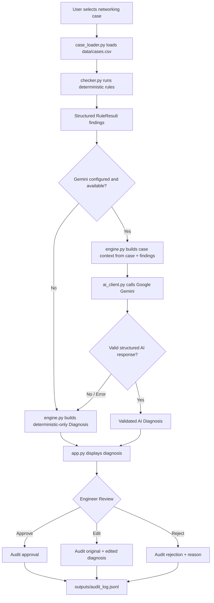

# Architecture

## Design Principle

NetSage AI is a **decision-support tool**, not an autonomous network controller.

The system uses a **deterministic-first, AI-assisted architecture**:

- Deterministic rule checks run first and provide the initial evidence-based findings.
- Gemini is used to explain and prioritize those findings when AI is configured and available.
- The AI layer does not replace the deterministic checks or independently execute network changes.
- A human engineer reviews every diagnosis and can approve, edit, or reject the recommendation.
- Review decisions are recorded in the audit log.

This architecture is intended to combine reproducible troubleshooting logic with AI-assisted explanation while maintaining human oversight.

---

## System Pipeline

The complete diagnostic workflow is:

```text
Application loads selected case
        |
        v
Case and evidence loaded
(src/case_loader.py + data/cases.csv)
        |
        v
Deterministic rule checker
(src/checker.py)
        |
        v
Structured findings
(List[RuleResult])
        |
        v
AI diagnosis / explanation
(src/engine.py -> src/ai_client.py)
        |
        v
Validated structured diagnosis
(Diagnosis)
        |
        v
Engineer verification and review
(app.py)
        |
        +-------------------+
        |                   |
     Approve              Edit
        |                   |
        +---------+---------+
                  |
                Reject
                  |
                  v
             Audit logging
          (src/audit.py)
                  |
                  v
      outputs/audit_log.jsonl
```

When Gemini is unavailable or not configured, the AI stage is skipped and the system produces a deterministic-only diagnosis.

---

## Mermaid Architecture Diagram



---

## Core Components

### 1. Dataset

```text
data/cases.csv
```

Contains the authoritative set of **30 networking troubleshooting cases** used by the application.

The dataset provides the scenario information and evidence used by the diagnostic pipeline.

The cases cover networking areas represented in the supplied project dataset, including IPv4 addressing, VLANs, trunking, inter-VLAN routing, DHCP, DNS, routing, OSPF, ACLs, NAT/PAT, wireless, port security, HSRP, IPv6 SLAAC, CDP, VTP, Dynamic ARP Inspection, and RADIUS.

---

### 2. Case Loader

```text
src/case_loader.py
```

Responsible for:

- Loading the case dataset.
- Validating the CSV structure.
- Looking up cases.
- Providing case information to the diagnostic pipeline.

---

### 3. Deterministic Rule Checker

```text
src/checker.py
```

The deterministic checker is the first diagnostic layer.

It analyzes the supplied case evidence using pattern-based troubleshooting rules.

The checker produces structured `RuleResult` findings containing information such as:

- Root cause
- Evidence
- OSI layer
- Severity
- Suggested diagnostic command
- Suggested fix

The deterministic layer runs before the Gemini API call.

This provides a reproducible diagnostic baseline and allows the application to continue working without AI.

---

### 4. Diagnosis Engine

```text
src/engine.py
```

The diagnosis engine coordinates the overall diagnostic process.

Its responsibilities include:

1. Running or receiving deterministic findings.
2. Building the application case context.
3. Preparing the information required by the AI layer.
4. Requesting an AI-assisted diagnosis when Gemini is available.
5. Validating the resulting diagnosis.
6. Falling back to deterministic-only diagnosis when the AI layer is unavailable or produces an unusable response.

---

### 5. Gemini AI Client

```text
src/ai_client.py
```

Provides the application's interface to Google Gemini.

The current application uses:

```text
gemini-3.5-flash-lite
```

The Gemini client is responsible for:

- Checking whether Gemini is configured.
- Sending the prepared diagnostic context to Gemini.
- Receiving the model response.
- Handling API/network/timeout/authentication failures.
- Extracting structured JSON from the response when necessary.
- Returning an AI response that can be validated by the diagnosis engine.

The Gemini API key is not stored in the repository.

For local development it is provided through environment configuration.

For the deployed Streamlit application it is provided through Streamlit Secrets.

---

### 6. Structured Diagnosis

```text
src/models.py
```

The application uses structured models to represent the major data objects involved in the diagnostic workflow.

These include:

- `Case`
- `RuleResult`
- `Diagnosis`
- `AuditRecord`

The structured diagnosis allows deterministic findings and AI-assisted explanations to be presented consistently in the application.

---

### 7. Streamlit Application

```text
app.py
```

The Streamlit application provides the user interface and connects the underlying modules.

It provides the major application stages:

1. Scenario Inspection & Human Review Gate
2. Deterministic Rule Validation
3. Diagnosis
4. Engineer Verification & Deployment Approval
5. Dashboard & Statistics
6. Audit History

The application also provides the human-in-the-loop review controls:

- Approve & Deploy Fix
- Edit Configuration Commands
- Reject Recommendation

The application does **not** automatically execute Cisco configuration commands.

---

### 8. Audit System

```text
src/audit.py
```

The audit system records review decisions in an append-only JSONL format.

The audit information can include:

- Case ID
- Diagnosis
- Review decision
- Edited diagnosis
- Rejection reason
- Timestamp
- Review outcome

The local audit output is:

```text
outputs/audit_log.jsonl
```

The JSONL approach is appropriate for local evaluation and demonstration.

A persistent external database would be more appropriate for a production multi-user deployment.

---

### 9. Evaluation Script

```text
evaluate.py
```

The evaluation script provides a reproducible check of the deterministic diagnostic layer against the 30 supplied cases.

It compares the deterministic output with each case's expected fault and reports the resulting evaluation accuracy.

The current project evaluation is:

```text
30/30 cases matched
100% deterministic evaluation accuracy
```

The evaluation is independent of the Gemini API.

---

## Module Responsibilities

| Module | Responsibility |
|---|---|
| `data/cases.csv` | Authoritative 30-case networking dataset. |
| `src/models.py` | Shared structured models: `Case`, `RuleResult`, `Diagnosis`, and `AuditRecord`. |
| `src/case_loader.py` | Loads and validates the CSV and provides case lookup/search functionality. |
| `src/checker.py` | Deterministic pattern-based troubleshooting rule engine. |
| `src/ai_client.py` | Google Gemini API wrapper and structured response extraction/recovery. |
| `src/engine.py` | Coordinates deterministic checking, AI diagnosis, validation, and deterministic fallback. |
| `src/audit.py` | Append-only JSONL audit logging and audit reading. |
| `src/utils.py` | Shared text normalization and evaluation utilities. |
| `prompts/diagnose_prompt.md` | Documents the AI diagnosis instructions and expected structured response format. |
| `app.py` | Streamlit application, user interface, workflow, review controls, dashboard, and statistics. |
| `evaluate.py` | Evaluates deterministic findings against the expected faults for all 30 cases. |

---

## Why Deterministic-First?

The system deliberately performs deterministic verification before requesting an AI diagnosis.

A pure LLM-based troubleshooting system can produce plausible explanations that are not sufficiently grounded in the supplied network evidence.

A purely rule-based system, on the other hand, is limited to patterns explicitly represented in its rule library and does not naturally provide broader explanations.

NetSage AI combines the two approaches:

```text
Deterministic Rules
        |
        | Grounded, reproducible findings
        v
Structured Evidence
        |
        | Explanation and prioritization
        v
Gemini AI
        |
        v
Human Review
```

The deterministic layer provides the evidence-based baseline, while Gemini provides an explanation and prioritization layer.

The human reviewer remains the final decision-maker.

---

## AI Safety and Fallback Design

The AI layer is treated as an optional component rather than a required dependency.

The application can operate in deterministic-only mode.

The main fallback paths are:

```text
Gemini unavailable
      |
      v
Deterministic-only diagnosis
```

and:

```text
Gemini response invalid
      |
      v
Response validation fails
      |
      v
Deterministic-only diagnosis
```

This prevents an AI provider failure from making the entire diagnostic application unusable.

---

## Failure Modes and Handling

### Missing or Malformed Dataset

If the case dataset cannot be loaded or does not meet the expected structure, the case-loading layer raises an appropriate error.

The Streamlit application presents an error instead of continuing with invalid case data.

---

### Unknown Case ID

If a requested case cannot be found, the case lookup layer returns no matching case and the application handles the missing case rather than attempting to diagnose nonexistent data.

---

### Gemini Not Configured

If Gemini credentials are not available:

```text
AIClient.is_available()
        |
        v
False
        |
        v
Deterministic-only Diagnosis
```

The application remains functional without an AI provider.

---

### Gemini API Failure

Network failures, authentication failures, provider errors, or timeouts are handled by the AI client.

The diagnosis engine then falls back to deterministic-only output.

---

### Malformed AI Response

If Gemini does not return the expected structured response, the AI response is processed and validated.

The system attempts safe JSON extraction/recovery where applicable.

If the response still cannot be validated, the application falls back to deterministic diagnosis.

---

### Rule Checker Failure

Individual rule evaluations are isolated so that an error in one rule does not unnecessarily terminate the complete diagnostic process.

The remaining applicable rules can continue to be evaluated.

---

## Deployment Architecture

The current application is deployed using Streamlit Community Cloud.

```text
GitHub Repository
       |
       v
Streamlit Community Cloud
       |
       v
app.py
       |
       +----------------------+
       |                      |
       v                      v
Local Case Dataset       Streamlit Secrets
       |                      |
       v                      v
Deterministic Rules      Gemini API
       |                      |
       +----------+-----------+
                  |
                  v
             Diagnosis
                  |
                  v
            Human Review
                  |
                  v
             Audit Log
```

The deployed application is available at:

```text
https://netsage-ai-by-vaibhav2176a.streamlit.app/
```

The Gemini API key is stored through Streamlit Secrets and is not included in the GitHub repository.

---

## Data Flow

The primary data flow through the system is:

```text
Case
 |
 +--> Symptom
 |
 +--> Topology Notes
 |
 +--> Networking Concept
 |
 +--> Severity
 |
 +--> Captured Cisco Show Output
 |
 v
Deterministic Checker
 |
 v
RuleResult Findings
 |
 +--------------------------+
 |                          |
 | Gemini unavailable       | Gemini available
 |                          |
 v                          v
Deterministic Diagnosis   Gemini Diagnosis
 |                          |
 +------------+-------------+
              |
              v
       Validated Diagnosis
              |
              v
        Engineer Review
        /      |       \
       /       |        \
   Approve    Edit     Reject
      |         |         |
      +---------+---------+
                |
                v
            Audit Log
```

---

## Architectural Properties

### Evidence-Based

The diagnosis begins with the supplied networking evidence and deterministic rule findings.

### Deterministic Baseline

The rule checker provides reproducible findings before AI assistance is introduced.

### AI-Assisted

Gemini adds explanation and prioritization to the existing evidence.

### Human Controlled

A human engineer reviews the diagnosis before it is treated as actionable.

### Fault Tolerant

AI failures do not prevent deterministic diagnosis.

### Auditable

Review decisions are recorded in the audit log.

### Non-Autonomous

The application recommends configuration changes but does not execute Cisco configuration commands automatically.
